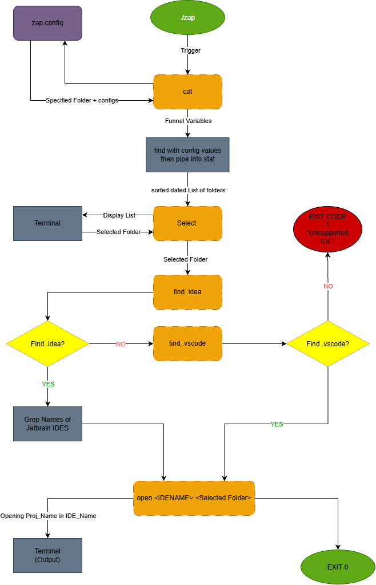

# Zap
Zsh script for mac that will show most recent projects and will auto open selected project in IDE

## Why?
It's very common to be working on multiple projects, and keeping track of how recent
or which IDE you used for the project can be annoying

## How does it work?
Zap will show you the 10 most recent projects youve opened,
and will let you open the project, along with its specified IDE
(No more opening 3 IDES to remember where you put that one Bash project)



## Tech Stack
- **Language:** Zsh
- **Libraries:** find, select, stat, grep, open

## Setup
```bash
git clone https://github.com/Kerim-Ucar/Zap
cd your-project
./zap-setup.sh <Project_Directory>
```

## Usage
```bash
./zap.sh #show N recent projects (Default: 10), edit in config
```

## Roadmap
- [ ] Add support for more IDEs
- [ ] Open spotify
- [ ] Ability to open multiple applications at once (Custom
- [ ] Detect IDE by language instead of IDE folder

## Author

Kerim Ucar, https://github.com/Kerim-Ucar